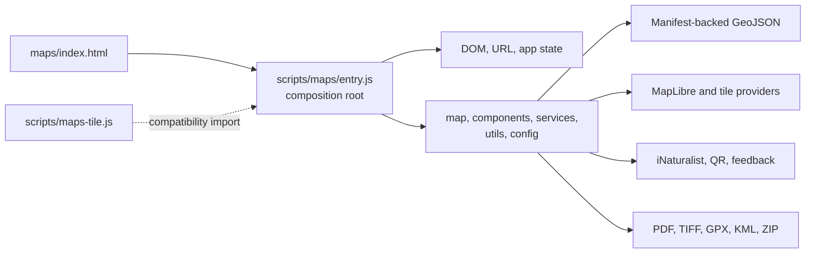

# Fovea website refactor assessment and plan

**Assessment date:** 2026-10-10  
**Scope:** Static review of the checked-out website source. This report does not cover the future Rust implementation. It recommends changes that make the existing JavaScript site easier to change safely while creating portable data and domain boundaries for that later work.

## Status update (2026-10-19)

This assessment records the original repository baseline and architectural rationale. Its measurements and statements about the production entry point describe the October 10 starting state, not the current checkout. Since then, `maps/index.html` now loads the 310-line composition root `scripts/maps/entry.js`; `scripts/maps-tile.js` is a two-line compatibility import; and the map stylesheet is an ordered entry point with partials. Shared map, sidebar, download, feedback, and mobile responsibilities have been extracted into focused modules. Provider clients now cover observations, feedback, QR generation, map URLs, and GeoJSON; versioned schemas, a dataset manifest, API contracts, and a CI workflow are in place. See `docs/refactor-handoff.md` for the current implementation state, verification history, preserved local changes, and remaining physical-device profiling gate.

The original phase plan below remains useful as a map of the intended architecture, but its near-term work order has been superseded by the status and priorities recorded at the end of this document.

## Executive summary

The main concern is valid: the map experience has grown into a tightly coupled browser application. Its production entry point is an 8,865-line script, `scripts/maps-tile.js`, coupled to a 6,500-line stylesheet, `styles/page-maps-tile.css`. It owns data loading, map rendering, selection, UI composition, downloads, external API calls, feedback submission, navigation, mobile gestures, and page initialization in one global scope.

There is an attempted module split under `scripts/map`, `scripts/components`, `scripts/services`, `scripts/utils`, and `scripts/config`. That split is a useful foundation, but it is not the code the live map page serves: `maps/index.html` still loads `scripts/maps-tile.js` directly. The extracted code also has incomplete behavior; for example, `scripts/map/map-init.js` contains a stub for updating the user-location marker. Switching the page to the extracted files wholesale would be a high-risk rewrite.

The practical strategy is an incremental strangler refactor: establish a stable modular entry point, move one complete capability at a time behind explicit contracts, verify visible behavior after each move, then delete the old implementation only when its replacement is live. This reduces the cost of adding client features now and leaves reusable contracts and validated data for a Rust rewrite later.

## Evidence from the repository

| Finding | Evidence | Consequence |
| --- | --- | --- |
| The production map is a monolith | `maps/index.html` loads `../scripts/maps-tile.js?v=247`; the file is 8,865 lines and defines at least 145 `addEventListener` calls. | A change to an isolated feature requires understanding unrelated state, event handlers, and DOM assumptions. |
| The modular replacement is not connected to production | The page does not import the files in `scripts/map`, `scripts/components`, or `scripts/services`; those files contain counterparts for map rendering, downloads, sidebar UI, feedback, and mobile navigation. | There are two competing implementations, inviting drift and making it unclear where a feature should be changed. |
| User-location behavior was a migration risk | `scripts/map/map-init.js` now creates and updates the MapLibre marker and accuracy circle, and geolocation tracking calls it; `tests/map-init.test.js` covers marker updates and location-zone behavior. | The earlier partial-extraction stub is resolved; the live map behavior is covered in the shared runtime module. |
| Shared behavior is implemented several times | Map, settings, wizard, and navigation code each define theme, toast, formatting, or mobile-navigation behaviors; `scripts/maps-tile.js`, `scripts/mobile-bottom-nav.js`, and `scripts/components/bottom-nav-view.js` all contain mobile bottom-nav logic. GeoJSON export selection, zone-ID matching, export filenames, file sharing, suggested-app settings and resolution, store fallback behavior, app selection presentation, and map bounds now have shared implementations. | Fixes can land in one implementation and fail to reach the route that customers use. |
| Page files contain application code and styling | `index.html` is 2,435 lines and includes extensive CSS and scripts; the map and download pages also depend on global CDN scripts and inline theme bootstrapping. | Templates cannot be reviewed as structure alone, and browser dependencies are implicit. |
| Startup previously preloaded nonessential map tiles | The low-resolution tile-warming loop has been removed. Startup loads only the requested GeoJSON dataset; MapLibre still controls tile cache and prefetch through its configured options. | Startup request counts are covered in Playwright. Tile-cache memory still needs a representative physical-device profile before changing MapLibre settings. |
| External dependencies and operational values are partly centralized | Map provider URLs, iNaturalist, QR URL construction, feedback POST, GeoJSON loading, app stores, and eBird lookup now have shared configuration or service boundaries. Some browser libraries remain CDN globals. | The active integrations have narrower test seams and contracts; the future Rust boundary remains documented. |
| Feedback acceptance cannot be verified in the browser | The feedback form posts with `mode: "no-cors"`, so its response is opaque to the page. | The interface says “request sent” and does not claim confirmed acceptance. Server-side confirmation still requires a CORS-enabled response contract. |
| Map deep-link state was duplicated | The live map and extracted data service each parsed `circle`, `cid`, `feature`, `zone`, and `id` independently. `scripts/map/map-route-state.js` now owns this contract and has unit coverage. | Route behavior is testable and compatible across the current entry point and future modular entry point. |
| Browser CI now runs on pushes and pull requests | `.github/workflows/ci.yml` passed on `ed683d8` after pinning the Node 24 action releases, selecting Node 24 and Ubuntu 24.04, and limiting token permissions to `contents: read`. | Hosted CI completed the checks with no Node 20 or `ubuntu-latest` migration notices. |
| Historical and active data coexist | `scripts/config/map-data-manifest.js` identifies each active served dataset with its edition, schema version, filename, source QMD, bounds, and SHA-256 checksum. Historical source files are outside the active manifest. | The active browser data version is explicit; archival labeling of every historical file remains a separate data-curation task. |

## Current coupling map



The original issue was less the number of files than the lack of boundaries. The active map now routes selection, data loading, export, UI, and provider behavior through modules with explicit callback wiring. The remaining entry is a 310-line composition root; `scripts/maps-tile.js` is a two-line compatibility import.

## Progress through this branch

The branch has established testable shared boundaries for route parsing, active map-data configuration and lazy loading, GeoJSON selection, zone formatting and descriptions, download filenames and share metadata, external app instructions and store fallbacks, KML/GPX/TIFF export conversion, print geometry, QR image loading, and location containment.

The live page loads `scripts/maps/entry.js`; the old script path remains only as a compatibility import. The current suite has 217 Node tests and ten Playwright checks, including deep links, downloads, mobile navigation, suggestion drawing, the header view toggle, responsive toolbar-modal placement, and download-wizard behavior. The hardened hosted CI workflow passed on `ed683d8`. The entry audit found no cohesive behavior that should move out of the composition root. Recent slices have moved provider request lifecycles, wizard data loading, stepper and selection views, compatible-app handoff, feedback drawing and annotation layers, mobile resize/snap handling, and toolbar modal/view behavior behind focused modules. See the handoff for verification details and the remaining physical-device profiling gate.

## Refactor goals and guardrails

1. Keep existing public URLs and query parameters working, including `circle`, `cid`, `feature`, `zone`, and `id`.
2. Preserve the static-site deployment model unless a feature needs a small server or edge endpoint.
3. Ship refactors in small, reversible changes that keep the map, exports, feedback, mobile gestures, and navigation usable after each release.
4. Put geographic data and export rules behind plain data contracts that Rust can consume later.
5. Do not start a broad JavaScript-to-Rust rewrite as part of this cleanup. The near-term return comes from predictable feature delivery and performance fixes.

## Target boundaries

The current extracted folders are close to a useful shape. Complete the architecture around explicit responsibilities rather than adding another layer of wrappers.

```text
scripts/
  maps/
    entry.js                 # Route bootstrap and dependency wiring only
    app-controller.js        # Coordinates route state and user intents
    state/route-state.js     # Selected circle, zone, tab, map style; no DOM
    data/geo-data-repository.js
    data/feature-schema.js
    map/map-adapter.js       # The only code that talks to MapLibre
    map/selection-controller.js
    exports/export-service.js
    integrations/
      observations-client.js
      feedback-client.js
      qr-client.js
    ui/
      sidebar-view.js
      modal-view.js
      mobile-layout.js
      toast-view.js
    shared/
      format.js
      geometry.js
      theme.js
      runtime-config.js
```

`app-controller.js` should be the only place that coordinates the boundaries. For example, a zone click becomes: controller updates route state, map adapter updates the map, sidebar view renders the selection, and export service reads the selected feature. Views should emit named callbacks; they should not import each other or mutate the shared state object.

The existing `state.js` can remain during transition, but it should shrink to route state and map-instance references with documented ownership. Do not allow every module to add new ad-hoc fields such as `_originalPlaceFilters` or `_hoveredFeatureId`; use named state groups or private module state instead.

## Prioritized plan

### Phase 0 — Establish a safe baseline (first 1–2 days)

1. Create a minimal Node project with a pinned package manager, formatter, linter, and a browser smoke-test runner. Use native ES modules and a lightweight bundler such as Vite only after confirming the hosting environment supports its generated assets.
2. Document canonical routes, active data files, URL parameters, external services, and customer-visible workflows: open a circle, choose a zone, change basemap, locate user, download each format, submit feedback, and use mobile navigation.
3. Add small unit tests for pure functions first: zone-ID normalization, URL parsing, GeoJSON selection, geometry checks, output filename generation, and KML/GPX generation. Add data validation that ensures the active GeoJSON files conform to the expected FeatureCollection schema.
4. Add a manual or automated browser smoke check for the workflows above before each modular migration. Capture the current behavior first; do not use a cleanup sprint to alter interaction design.
5. Choose and document the canonical file for every duplicate route and utility. Keep redirect or compatibility pages only where a published URL requires them.

**Exit condition:** contributors can run one documented command for linting and one for the smoke checks, and there is one written source of truth for routes, data, and external dependencies.

### Phase 1 — Fix immediate performance and reliability issues (1–3 days)

1. Limit preloading to the active base layer, defer it until after first render or `requestIdleCallback`, and measure request count before and after.
2. Add dataset versions and cancellation to the GeoJSON repository. The initial view now loads alone, and Eugene, Florence, or the overview data load only when selected and remain cached.
3. Set map cache and prefetch values from a single performance configuration. Profile memory on a representative mobile device before retaining `maxTileCacheSize: 2500` and `prefetchZoomDelta: 8`.
4. Centralize provider URLs, request timeouts, error mapping, and telemetry hooks in integration clients. Make requests abortable when a user changes selection or leaves a view.
5. Replace the `no-cors` feedback submission design with an endpoint that returns an allowed, structured response. Until that is available, label the UI result as a request sent rather than confirmed submission.

**Exit condition:** the map begins rendering with only the default data, repeated tile preloads are gone, and external failures have an understandable UI state.

### Phase 2 — Migrate the map application incrementally (1–3 weeks)

Create a module entry point, for example `scripts/maps/entry.js`, but do not point the live page at it until the first vertical slice is complete. Move complete capabilities in this order:

1. **Pure shared code:** use the existing format, geometry, color, and configuration modules. Delete the matching copies from the monolith only after imports are live.
2. **Data repository and route state:** consolidate data paths and `getInitialIdFromUrl` / selection rules. Preserve every current URL form with tests.
3. **Map adapter and selection:** move MapLibre initialization, layer creation, selection, hover, basemap switching, and user location as one vertical slice. Implement the missing location marker behavior before promotion.
4. **Sidebar and header views:** move rendering and event binding into views that receive data and callbacks. Prefer event delegation for regenerated list content.
5. **Exports:** migrate GeoJSON, KML, GPX, PDF, TIFF, and app handoff code as a single service with typed inputs and output tests.
6. **Modals, feedback, search, and mobile interactions:** move these after the data and selection contracts are stable. Reuse one mobile-nav implementation, not the three current copies.

For each slice:

1. Add or update a behavior test.
2. Import the new module from a transitional entry point.
3. Compare it with the live flow in desktop and mobile browsers.
4. Remove the corresponding monolith function and dead copy in the same pull request when no caller remains.

Avoid a mixed state where both implementations service the same action. The present repository already demonstrates why: copied functions have begun to diverge.

**Exit condition:** `maps/index.html` loads one module entry point, no production map logic remains in `scripts/maps-tile.js`, and each capability has a single implementation.

### Phase 3 — Normalize pages, CSS, and operations (1–2 weeks, can overlap Phase 2)

1. Move inline home-page CSS and script blocks out of `index.html`. Split styles by shared tokens, page shell, component, and map feature. Preserve the critical theme bootstrap as a tiny documented inline script if needed to prevent flash of the wrong theme.
2. Adopt component naming and a narrow DOM contract. Each UI module should own a root element and the class names it changes; map code should not restyle sidebar elements directly.
3. Replace manual cache-busting query versions such as `?v=246` and `?v=121` with content-hashed build assets or one documented release version.
4. Provide one `runtime-config` module for non-secret public settings and provider endpoints. Keep secrets off the client; browser storage is not a safe credential store. The current `github_token` check is marked as future placeholder behavior and should be removed or replaced before enabling authenticated editing.
5. Create a data manifest with a dataset ID, display name, version, source file, bounds, and checksum. Make the conversion scripts generate or validate it. Store only the current served files in the active manifest; archive or clearly label historical source files.

**Exit condition:** there is one canonical route per page, one canonical stylesheet per component family, and all runtime integrations and datasets are discoverable from configuration.

### Phase 4 — Prepare for Rust without starting the rewrite (ongoing)

1. Define versioned JSON schemas for circles, zones, optional bird observations, feedback payloads, and export requests. Validate these schemas in the current frontend and later in Rust.
2. Keep map rendering and browser UX in the frontend boundary. Treat geographic data access, validation, transformation, caching, and any authenticated workflows as portable service contracts.
3. Write a short API contract for each external provider: input, response normalization, caching behavior, timeout, retry policy, and user-facing fallback.
4. If data volume or client-side conversion becomes a demonstrated bottleneck, introduce a small endpoint that can later be implemented in Rust. Keep the frontend calling a stable HTTP/JSON contract.

This creates useful migration assets: test cases, data schemas, normalized fixtures, and API contracts. It avoids paying now for a second full implementation of the interface.

## Near-term work order

The original ordering below has been replaced with this status-based queue as of 2026-10-19:

| Status | Work |
| --- | --- |
| Complete or in place | Entry/compatibility audit; provider cancellation, timeouts, and active-basemap error messages; shared wizard data repository with stepper, selection-view, and app-handoff components; feedback and mobile view decomposition; versioned schemas, provider contracts, dataset manifest, and hardened CI workflow. Hosted CI and Pages deployment succeeded through `b800dc1`; see the latest checkpoint in `docs/refactor-handoff.md`. |
| Requires external evidence/state | Profile MapLibre cache memory on a representative physical mobile device before changing cache/prefetch settings. The user currently has no physical-device test setup. |

The download-wizard controller is now below the 500-line soft limit after extracting its distinct stepper, selection-view, and compatible-app handoff responsibilities. Remaining cache profiling is gated on access to a representative physical mobile device; see the handoff for current status.

## Risks to manage

| Risk | Control |
| --- | --- |
| Breaking deep links used by clients | Freeze a URL compatibility table and cover it with route-state tests before migrating selection. |
| Mobile regressions from DOM and gesture changes | Require a short mobile smoke check for every map slice; keep the existing markup until a view has parity. |
| Incorrect export files | Build fixture-based tests for a circle, a zone, a multi-polygon, and a polygon with a hole. |
| Provider rate limits or outages | Give each provider an integration client with timeout, cancellation, fallback, and visible error behavior. |
| Long-running migration leaves two sources of truth | Migrate and delete each capability in one change; do not continue copying fixes between the monolith and modules. |
| Rust work restarts the design discussion | Treat data schemas and HTTP contracts as the stable handoff, and defer framework choices until the Rust project begins. |

## Suggested success measures

Track the following before and after the first two phases:

- Initial map render time, number of startup network requests, JavaScript transfer size, and memory on a target mobile device.
- Number of production files above 500 lines and number of duplicate implementations of a feature.
- Smoke-test pass rate for map selection, exports, feedback, and mobile navigation.
- Time required to add a dataset, layer, export format, or client-requested map interaction.
- Number and clarity of customer-visible failures from external services.

## Recommended first implementation ticket

**Map startup and data-loading baseline:** defer low-resolution raster preloading until after first render; load only the active circle GeoJSON at startup; cache area datasets by manifest ID; and add a browser smoke check confirming circle selection, Eugene selection, and Florence selection still work.

It delivers measurable performance value, establishes the data repository boundary needed for the larger refactor, and changes no customer-facing workflow.
